# Hướng dẫn sử dụng nhanh — App rà soát hồ sơ KSK 2026

Rà soát hồ sơ giấy khám sức khỏe toàn dân 2026. Làm theo từng bước, đối chiếu số trong khung đỏ ở ảnh với số đầu dòng bên dưới.

> Bản trong app: mục **Hướng dẫn** trên menu (`/huong-dan`). Bản in: `docs/huong-dan-nhanh.pdf`. Ảnh chụp trên dữ liệu **giả**, không phải người dân thật.

## Mục lục

- [5 bước rà soát một hồ sơ](#5-bước-rà-soát-một-hồ-sơ)
- [Phím tắt](#phím-tắt-trên-màn-rà-soát)
- [1. Đăng nhập](#dang-nhap)
- [2. Theo dõi tiến độ trên trang Danh sách của tôi](#dashboard)
- [3. Mở danh sách rà soát](#mo-danh-sach)
- [4. Tìm hồ sơ trong danh sách](#tim-kiem)
- [5. Kiểm tra và sửa cận lâm sàng](#sua-cls)
- [6. Sửa thông tin hành chính và lưu](#sua-hanh-chinh)
- [7. Xác nhận hồ sơ](#xac-nhan)
- [8. Lọc hồ sơ chưa xác nhận và lọc nhanh](#loc)
- [9. Loại hồ sơ khỏi danh sách](#loai-khoi)
- [10. Thêm hồ sơ và kiểm trùng](#them-ho-so)
- [11. Nhận hồ sơ vào danh sách (từ kho)](#nhan-tu-kho)
- [12. Kho chờ cá nhân và kho chờ chung](#kho-cho)
- [13. Tìm toàn app và đề nghị chuyển](#tim-toan-app)
- [14. Thông báo đề nghị chuyển](#thong-bao-de-nghi)
- [15. Chốt danh sách](#chot)
- [16. Câu hỏi thường gặp](#hoi-dap)
- [17. Dành cho admin](#admin)

## 5 bước rà soát một hồ sơ

| Bước | Việc làm | Cụ thể |
|:--:|---|---|
| **1** | **Tìm** | Lấy hồ sơ giấy, gõ tên không dấu vào ô tìm. |
| **2** | **Đối chiếu** | So họ tên, năm sinh, CCCD và 8 cận lâm sàng với giấy. |
| **3** | **Sửa nếu khác giấy** | Bấm ô cận lâm sàng hoặc mở chi tiết để sửa theo giấy. |
| **4** | **Xác nhận** | Khớp giấy thì tích “Đã kiểm – có hồ sơ giấy”. |
| **5** | **Chốt danh sách** | Hết hồ sơ thì bấm “Xác nhận rà soát xong danh sách”. |

## Phím tắt trên màn rà soát

| Phím | Việc làm |
|---|---|
| `/` | Đưa con trỏ vào ô tìm kiếm / quay lại ô tìm (chữ cũ tự bôi đen để gõ đè) |
| `↓ / Enter (đang ở ô tìm)` | Xuống danh sách, chọn dòng đầu kết quả |
| `↑ / ↓` | Chọn dòng trên / dòng dưới |
| `Space` | Xác nhận hoặc bỏ xác nhận hồ sơ đang chọn |
| `1 – 8` | Đổi ô cận lâm sàng thứ 1–8 (CTM, GLU, URE, CRE, GOT, GPT, NT, SA) |
| `Enter` | Mở khung chi tiết (nhấp đúp vào dòng cũng được) |
| `K` | Đưa hồ sơ vào kho của tôi |
| `C` | Đưa hồ sơ vào kho chờ chung |

## 1. Đăng nhập

**Khi nào dùng:** Mỗi lần bắt đầu làm việc. Dùng Chrome hoặc Edge trên máy tính.

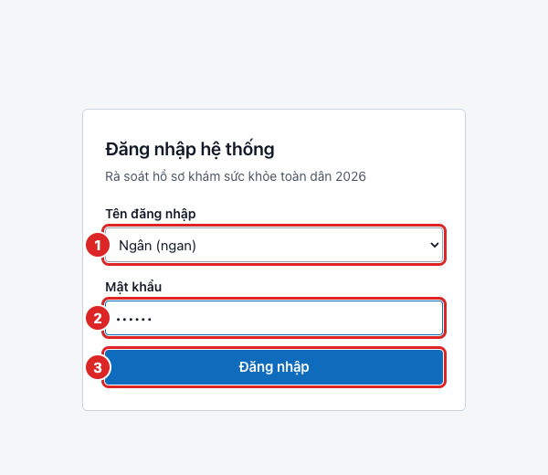

① Bấm ô **Tên đăng nhập** và chọn **tên của mình** trong danh sách.

② Gõ **mật khẩu** do admin phát (ban đầu là `123456`).

③ Bấm **Đăng nhập**.

> **Lưu ý**
> - Muốn đổi mật khẩu: bấm **Đổi mật khẩu** ở góc trên bên phải sau khi đăng nhập.
> - Gõ sai mật khẩu nhiều lần, app khóa tạm 15 phút. Quên mật khẩu thì nhờ admin đặt lại.

## 2. Theo dõi tiến độ trên trang Danh sách của tôi

**Khi nào dùng:** Sau khi đăng nhập: xem mình phụ trách buổi nào, đã làm được bao nhiêu.

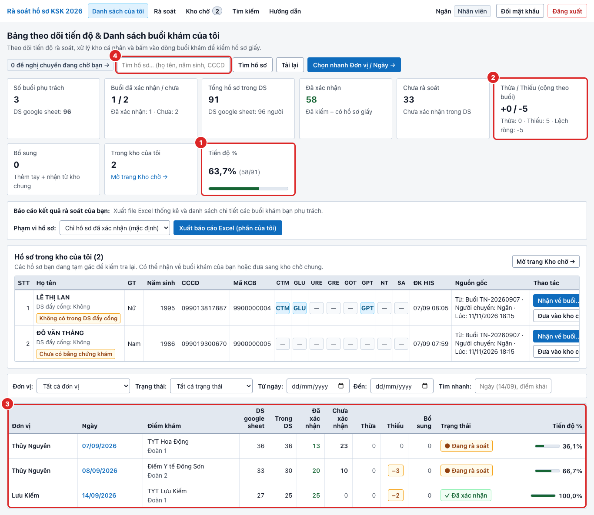

① Xem thẻ **Tiến độ %**: số hồ sơ đã xác nhận trên tổng số hồ sơ trong danh sách của bạn.

② Xem thẻ **Thừa / Thiếu**: danh sách trên máy nhiều hơn hay ít hơn so với **DS google sheet** (sổ đoàn).

③ Bấm vào **ngày khám** (chữ xanh) của một buổi trong bảng để mở danh sách rà soát của buổi đó.

④ Gõ tên, năm sinh hoặc CCCD vào ô **Tìm hồ sơ**, bấm **Tìm hồ sơ**: app mở trang **Tìm kiếm** với kết quả.

> **Lưu ý**
> - Buổi có nhãn **Đã xác nhận** là buổi đã chốt xong, không cần làm tiếp.

## 3. Mở danh sách rà soát

**Khi nào dùng:** Khi bắt đầu rà soát một buổi khám. Đây là màn hình bạn làm việc nhiều nhất.

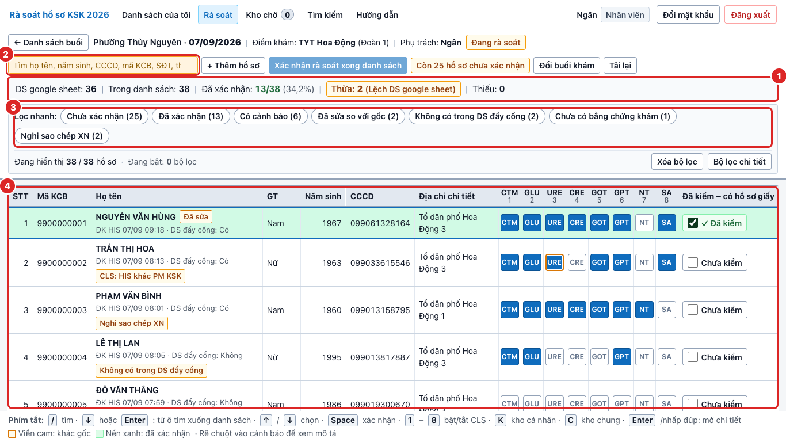

① Đọc **thanh chỉ số**: DS google sheet, Trong danh sách, **Đã xác nhận** (x/y), Thừa, Thiếu.

② Dùng **ô tìm** để tìm nhanh một hồ sơ (phím `/`).

③ Dùng **Lọc nhanh** để chỉ xem nhóm hồ sơ cần chú ý (chưa xác nhận, có cảnh báo…).

④ Làm việc trên **bảng hồ sơ**: mỗi dòng một người, 8 ô cận lâm sàng ở bên phải, ô xác nhận ở cuối dòng.

> **Lưu ý**
> - Dòng **nền xanh** là hồ sơ đã xác nhận. Ô có **viền cam** là ô đã sửa so với dữ liệu gốc.

## 4. Tìm hồ sơ trong danh sách

**Khi nào dùng:** Khi cầm một hồ sơ giấy và cần tìm đúng dòng của người đó.

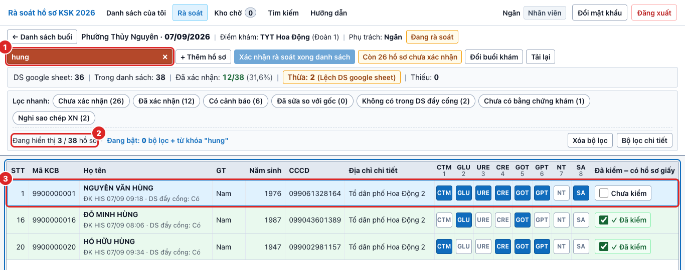

① Bấm vào **ô tìm** (hoặc nhấn `/`) rồi gõ **tên không dấu**, năm sinh hoặc 4 số cuối CCCD. Ô trống có nền **vàng cam nhạt** (chưa tìm); khi có chữ sẽ đổi sang nền **màu gạch**, chữ trắng (đang tìm).

② Nhìn dòng **Đang hiển thị 3 / 38 hồ sơ**: bảng chỉ còn những người khớp từ khóa.

③ Nhấn `↓` hoặc `Enter` để từ ô tìm **xuống danh sách**, chọn dòng đầu kết quả (có viền nhấn); sau đó dùng `Space`, `1`–`8`, `Enter`, `K`, `C` bình thường trên danh sách đã lọc.

④ Nhấn `/` để **quay lại ô tìm** (chữ cũ được bôi đen để gõ đè tên người tiếp theo).

> **Lưu ý**
> - Tìm không phân biệt dấu và chữ hoa/thường: gõ “thuy” vẫn ra “Thủy”, “Thuỷ”.
> - Xóa tìm kiếm: bấm dấu **×** trong ô hoặc nhấn `Esc`.

## 5. Kiểm tra và sửa cận lâm sàng

**Khi nào dùng:** Khi so 8 cận lâm sàng trên máy với phiếu giấy.

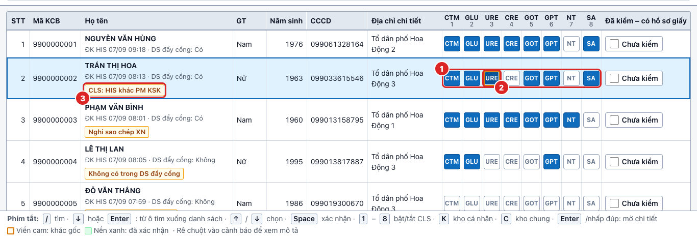

① Nhìn **8 ô cận lâm sàng**: CTM, GLU, URE, CRE, GOT, GPT, NT, SA. Ô **xanh** là có làm, ô **xám** là không làm. So từng ô với phiếu giấy.

② Ô nào **khác giấy** thì bấm vào ô đó (hoặc nhấn phím `1`–`8`) để đổi. Ô đã sửa có **viền cam**; bấm lần nữa để trả lại như cũ.

③ Gặp **nhãn cảnh báo** (vàng cam): rê chuột vào nhãn để đọc giải thích, rồi xem kỹ phiếu giấy.

> **Lưu ý**
> - Chỉ có 8 cận lâm sàng này; kỹ thuật khác không nhập vào app.

## 6. Sửa thông tin hành chính và lưu

**Khi nào dùng:** Khi họ tên, giới tính, năm sinh, CCCD hoặc địa chỉ trên máy khác phiếu giấy.

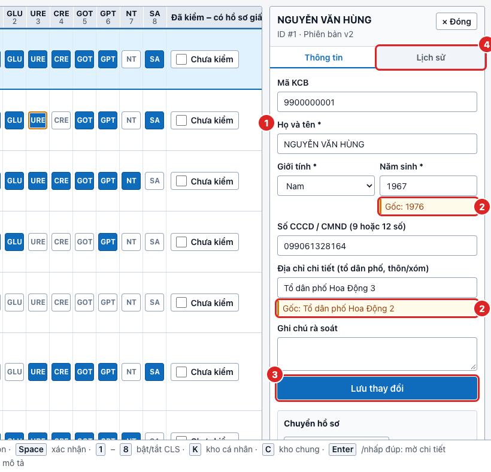

① **Nhấp đúp** vào dòng (hoặc chọn dòng rồi nhấn `Enter`) để mở khung chi tiết bên phải. Sửa các ô khác giấy: họ tên, giới tính, năm sinh, CCCD, địa chỉ.

② Dòng **Gốc: …** màu cam cho biết giá trị ban đầu, để bạn biết mình đã sửa gì.

③ Bấm **Lưu thay đổi**. Chưa bấm thì chưa được lưu.

④ Bấm tab **Lịch sử** để xem ai đã sửa gì, lúc nào.

> **Lưu ý**
> - CCCD để trống hoặc đủ 9 hoặc 12 số. Họ tên và năm sinh không được để trống.

## 7. Xác nhận hồ sơ

**Khi nào dùng:** Khi hồ sơ trên máy đã khớp với hồ sơ giấy (sau khi đã sửa nếu có khác).

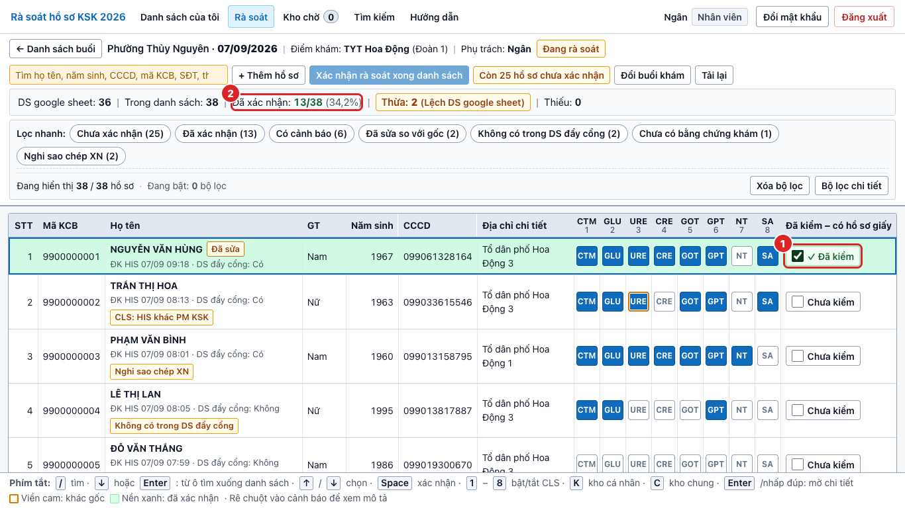

① Tích ô **Đã kiểm – có hồ sơ giấy** ở cuối dòng (hoặc chọn dòng rồi nhấn `Space`). Dòng chuyển **nền xanh**.

② Nhìn số **Đã xác nhận** trên thanh chỉ số tăng thêm 1.

> **Lưu ý**
> - Tích nhầm thì bấm lần nữa để bỏ xác nhận.

## 8. Lọc hồ sơ chưa xác nhận và lọc nhanh

**Khi nào dùng:** Khi muốn biết còn những hồ sơ nào phải làm, hoặc chỉ xem một nhóm hồ sơ.

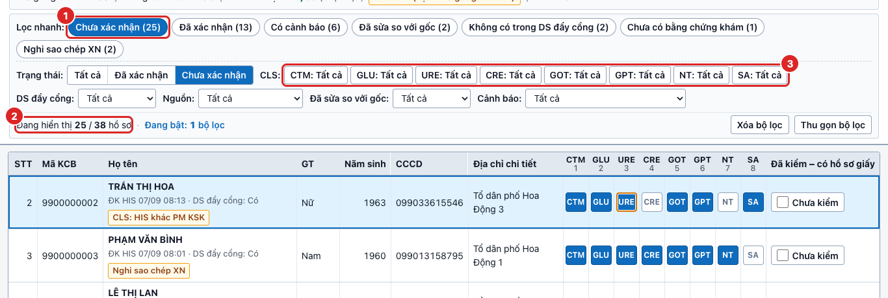

① Bấm nút **Chưa xác nhận (25)** trong mục **Lọc nhanh**: bảng chỉ còn hồ sơ chưa làm.

② Xem dòng **Đang hiển thị 25 / 38 hồ sơ** để biết còn bao nhiêu.

③ Bấm **Bộ lọc chi tiết** để lọc theo từng cận lâm sàng: bấm một ô để xoay vòng **Tất cả → Có → Không**.

> **Lưu ý**
> - Bấm **Xóa bộ lọc** để trở lại xem toàn bộ danh sách.

## 9. Loại hồ sơ khỏi danh sách

**Khi nào dùng:** Khi hồ sơ có trên máy nhưng không có giấy, hoặc không thuộc buổi này.

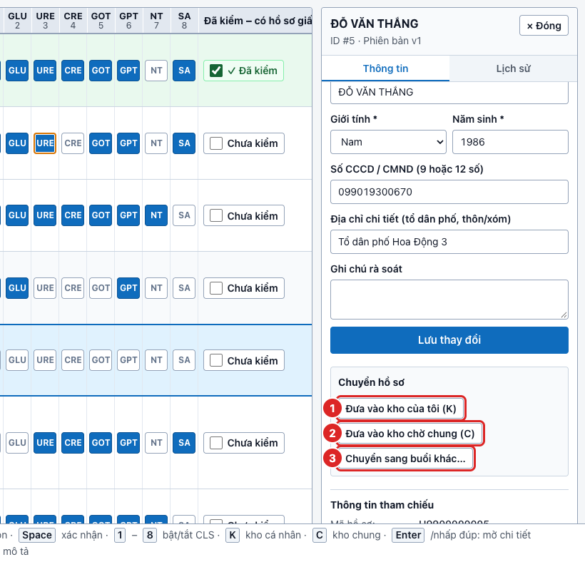

① **Đưa vào kho của tôi** (phím `K`): không thấy giấy, nghi khám ngày khác. Hồ sơ nằm chờ để bạn xem lại sau.

② **Đưa vào kho chờ chung** (phím `C`): không phải người của buổi mình, để người phụ trách khác nhận. App hỏi lý do.

③ **Chuyển sang buổi khác…**: biết chắc người này khám buổi nào.

### Chuyển sang buổi khác

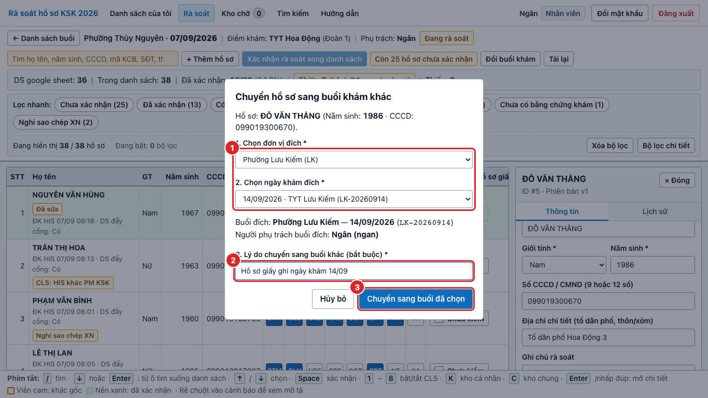

① Chọn **đơn vị** và **ngày khám đích**.

② Gõ **lý do** (bắt buộc), ví dụ “Hồ sơ giấy ghi ngày khám 14/09”.

③ Bấm **Chuyển sang buổi đã chọn**.

> **Lưu ý**
> - Hồ sơ **đã xác nhận** phải **bỏ xác nhận** trước (bấm lại ô Đã kiểm) thì mới chuyển được.
> - Buổi đã chốt (khóa) không nhận hồ sơ chuyển vào.

## 10. Thêm hồ sơ và kiểm trùng

**Khi nào dùng:** Có hồ sơ giấy nhưng tìm khắp nơi không thấy người đó trên máy.

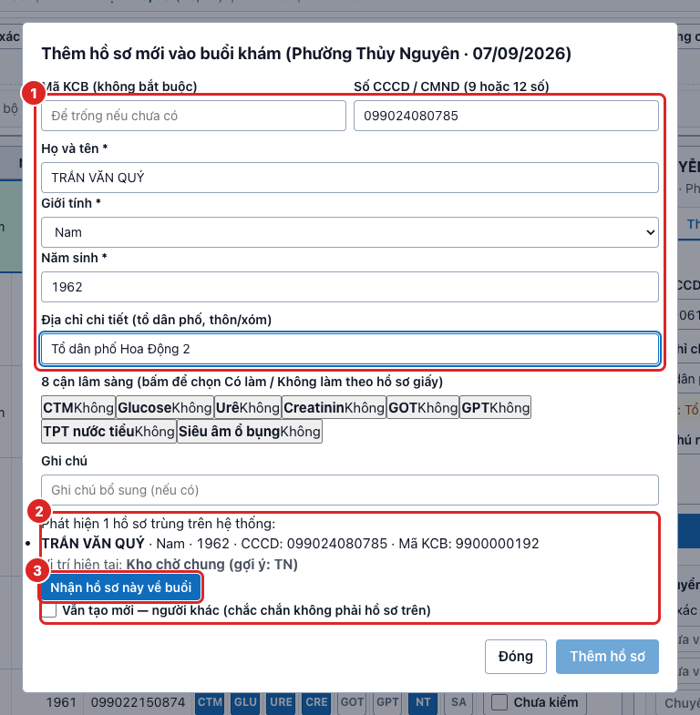

① Bấm **+ Thêm hồ sơ** phía trên bảng. Điền họ tên, giới tính, năm sinh (bắt buộc), CCCD, địa chỉ nếu có; bấm 8 ô cận lâm sàng theo giấy. Mã KCB có thể để trống.

② Nếu hiện khung **Phát hiện … hồ sơ trùng**, người này đã có trong hệ thống: **không tạo mới**.

③ Hồ sơ trùng đang ở kho thì bấm **Nhận hồ sơ này về buổi**. Đang ở buổi người khác thì bấm **Đề nghị chuyển về buổi này**.

> **Lưu ý**
> - Chỉ khi chắc chắn là **người khác** mới tích “Vẫn tạo mới” và ghi lý do.
> - Hồ sơ thêm tay được xác nhận ngay khi thêm.

## 11. Nhận hồ sơ vào danh sách (từ kho)

**Khi nào dùng:** Có hồ sơ giấy của một người đang nằm trong kho chờ chung hoặc kho của tôi.

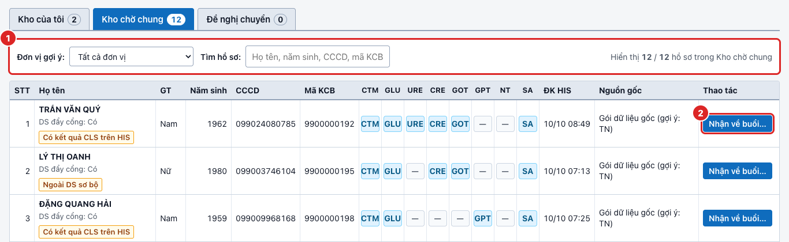

① Bấm **Kho chờ** trên thanh menu, chọn tab **Kho chờ chung**. Lọc theo **đơn vị** hoặc gõ tên vào ô **Tìm hồ sơ**.

② Ở dòng đúng người, bấm **Nhận về buổi…**, chọn buổi bạn phụ trách rồi bấm **Nhận về buổi khám**.

> **Lưu ý**
> - Hồ sơ nhận về sẽ vào danh sách của buổi bạn chọn. Nhớ đối chiếu và xác nhận như hồ sơ khác.

## 12. Kho chờ cá nhân và kho chờ chung

**Khi nào dùng:** Để xem lại những hồ sơ đã tạm cất đi.

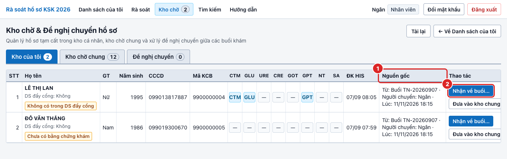

① Cột **Nguồn gốc** cho biết hồ sơ đến từ buổi nào, ai chuyển, lúc nào.

② Bấm **Nhận về buổi…** để đưa hồ sơ trở lại danh sách của buổi bạn phụ trách.

- **Kho của tôi**: chỉ bạn thấy. Dùng cho hồ sơ “chưa chắc, xem lại sau”.
- **Kho chờ chung**: ai cũng thấy. Dùng cho hồ sơ không thuộc buổi của bạn, người khác có thể nhận.
- Con số cạnh chữ **Kho chờ** trên menu là số hồ sơ trong kho của tôi.

## 13. Tìm toàn app và đề nghị chuyển

**Khi nào dùng:** Có giấy của một người nhưng người đó đang nằm trong buổi của nhân viên khác.

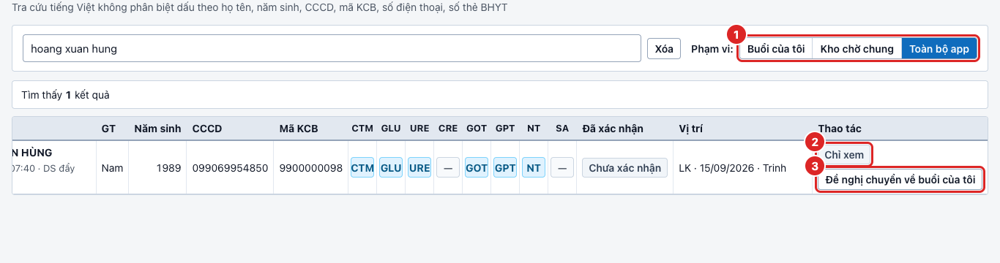

① Bấm **Tìm kiếm** trên menu, gõ tên không dấu, chọn **Phạm vi**: Buổi của tôi, Kho chờ chung hoặc **Toàn bộ app**.

② Người thuộc buổi của người khác chỉ có nhãn **Chỉ xem**: bạn không sửa được hồ sơ đó.

③ Bấm **Đề nghị chuyển về buổi của tôi**, chọn buổi đích, ghi lý do rồi gửi. Chờ người phụ trách đồng ý.

### Nếu bạn là người nhận đề nghị

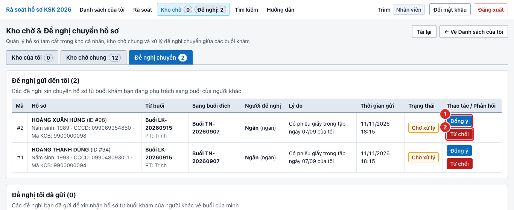

① Vào **Kho chờ**, tab **Đề nghị chuyển** (menu hiện **Đề nghị: n** khi có đề nghị chờ). Bấm **Đồng ý** nếu đúng: hồ sơ chuyển sang buổi của người đề nghị.

② Bấm **Từ chối** nếu không đúng (có thể ghi lý do ngắn gọn).

## 14. Thông báo đề nghị chuyển

**Khi nào dùng:** Khi nhân viên khác gửi đề nghị xin chuyển hồ sơ từ buổi bạn đang phụ trách sang buổi của họ.

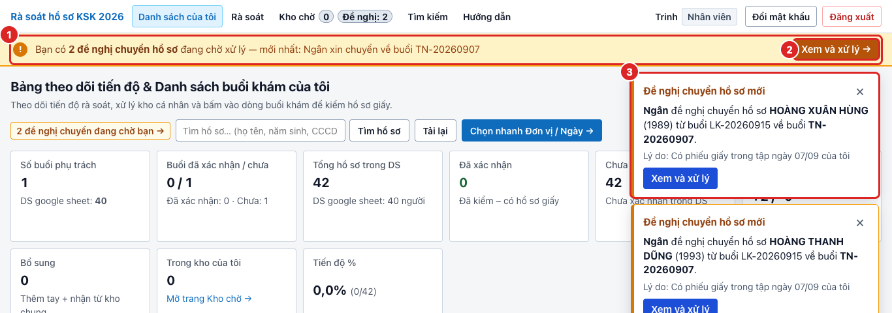

① **Dải vàng** ngay dưới thanh trên cùng báo bạn có bao nhiêu đề nghị chuyển hồ sơ đang chờ xử lý và đề nghị mới nhất từ ai.

② Bấm **Xem và xử lý →** trên dải vàng (hoặc **Xem và xử lý** trong popup) để mở tab **Đề nghị chuyển**, rồi bấm **Đồng ý** hoặc **Từ chối** (như ảnh mục trên).

③ Đọc **popup góc phải** cho mỗi đề nghị mới: biết rõ ai xin chuyển, hồ sơ nào, từ buổi nào về buổi nào và lý do.

> **Lưu ý**
> - Popup góc phải **tự mờ và tắt sau 10 giây**, nhưng **dải vàng** vẫn còn cho đến khi bạn xử lý xong hết các đề nghị.
> - Trên thanh menu, mục **Kho chờ** cũng hiện huy hiệu **Đề nghị: N** báo số đề nghị đang chờ.

## 15. Chốt danh sách

**Khi nào dùng:** Khi mọi hồ sơ của buổi đã xác nhận xong.

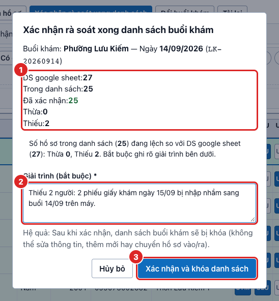

① Bấm **Xác nhận rà soát xong danh sách** (nút xanh, sáng lên khi hết hồ sơ chưa xác nhận). Đọc phần **tóm tắt**: DS google sheet, trong danh sách, đã xác nhận, thừa, thiếu.

② Nếu số hồ sơ **lệch DS google sheet**, ghi **giải trình** (bắt buộc), ví dụ “2 phiếu khám ngày 15/09 nhập nhầm sang buổi này”.

③ Bấm **Xác nhận và khóa danh sách**.

### Sau khi chốt

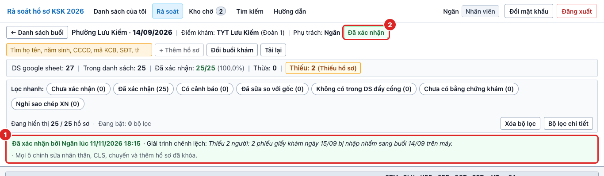

① Dải xanh **Đã xác nhận bởi …** ghi người chốt, thời điểm và giải trình.

② Nhãn **Đã xác nhận** cạnh tên buổi: danh sách đã khóa.

> **Lưu ý**
> - Danh sách đã khóa thì không sửa, thêm hay chuyển hồ sơ được nữa. Cần sửa: báo admin **mở khóa**.

## 16. Câu hỏi thường gặp

**Khi nào dùng:** Khi gặp tình huống chưa rõ phải làm gì.

- **Tôi sửa nhầm thì sao?** Ô cận lâm sàng: bấm lại để trả về. Thông tin hành chính: nhìn dòng “Gốc: …”, gõ lại giá trị cũ rồi **Lưu thay đổi**. Mọi lần sửa đều ghi vào tab **Lịch sử**, không sợ mất dấu.
- **Có giấy nhưng không tìm thấy người đó?** Thử gõ ít chữ hơn (chỉ tên, hoặc năm sinh, hoặc 4 số cuối CCCD). Rồi tìm ở **Kho chờ chung** và **Tìm kiếm → Toàn bộ app**. Vẫn không có thì **Thêm hồ sơ**.
- **Trên máy có người nhưng không có hồ sơ giấy?** Nhấn `K` đưa vào **kho của tôi** và xem lại cuối buổi. Chắc chắn không phải người của buổi mình thì đưa vào **kho chờ chung** (nhấn `C`).
- **App báo “Hồ sơ vừa được người khác sửa, đã tải lại bản mới nhất”?** Hai người cùng mở một hồ sơ và người kia lưu trước. App đã tải bản mới: xem lại rồi sửa tiếp phần của bạn.
- **Không chuyển được hồ sơ?** Hồ sơ đã xác nhận phải bỏ xác nhận trước. Buổi đích đã chốt cũng không nhận thêm.
- **Danh sách đã khóa mà cần sửa?** Báo admin (BS Khôi) mở khóa. Sửa xong thì chốt lại.
- **Số lượng lệch DS google sheet (thừa/thiếu)?** Không sao nếu có lý do. Tìm thêm giấy ở kho; không có thì chốt và ghi giải trình.

## 17. Dành cho admin

**Khi nào dùng:** Chỉ tài khoản quản trị (BS Bùi Minh Khôi) thấy các mục này trên menu.

### Tổng quan

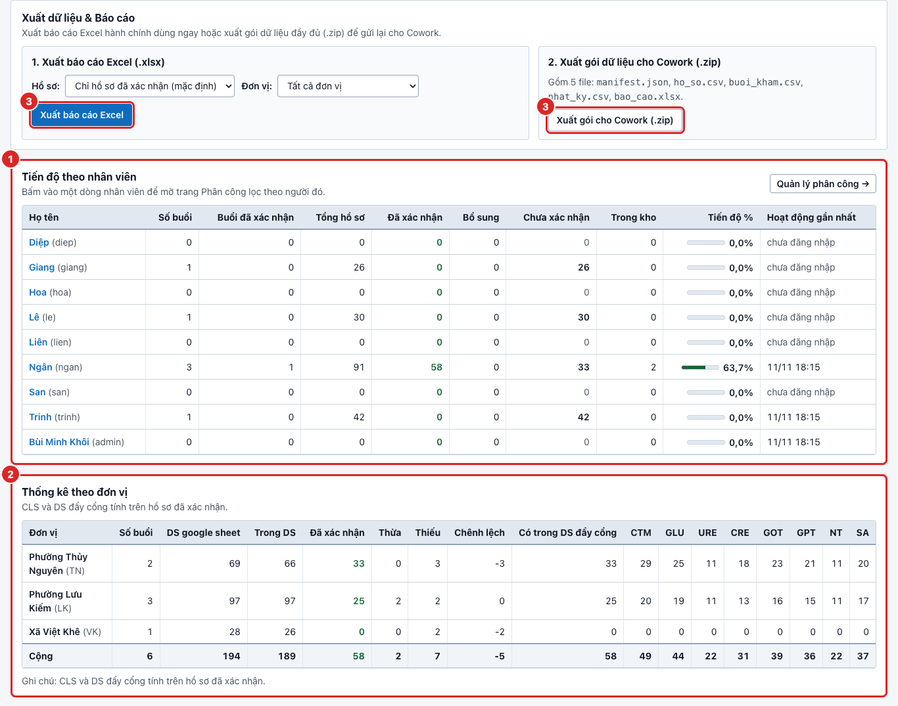

① Bảng **Tiến độ theo nhân viên**: ai đã làm đến đâu. Bấm tên để mở trang Phân công lọc theo người đó.

② Bảng **Thống kê theo đơn vị**: DS google sheet, trong danh sách, đã xác nhận, thừa/thiếu, từng cận lâm sàng.

③ Nút **Xuất báo cáo Excel** và **Xuất gói cho Cowork (.zip)** ở phần Xuất dữ liệu & Báo cáo.

### Phân công

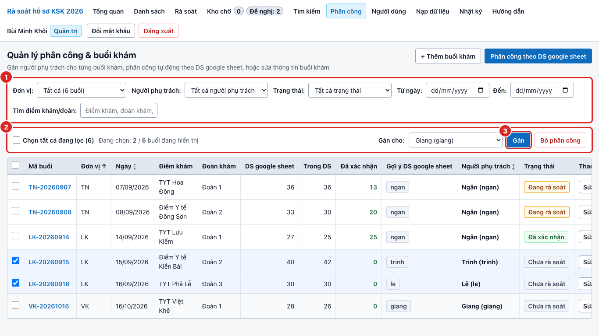

① Dùng **bộ lọc** (đơn vị, người phụ trách, trạng thái, ngày) để thu hẹp danh sách buổi.

② Tích các buổi cần gán (hoặc **Chọn tất cả đang lọc**), chọn người ở ô **Gán cho**.

③ Bấm **Gán**. Nút **Phân công theo DS google sheet** gán tự động theo gợi ý của sổ đoàn.

- **Người dùng**: thêm tài khoản, khóa/mở khóa, đặt lại mật khẩu về `123456`.
- **Nạp dữ liệu**: nạp gói dữ liệu mới của Cowork. Luôn bấm **Chạy thử** và đọc kết quả trước khi nạp thật.
- **Nhật ký**: xem mọi thao tác sửa (ai, lúc nào, giá trị cũ và mới).
- **Mở khóa danh sách**: vào buổi đã chốt, bấm **Mở khóa**, ghi lý do.
- **Xuất**: cuối đợt, xuất gói Cowork và báo cáo Excel lần cuối rồi báo gỡ hệ thống.

